# AetherCFD Studio

AetherCFD Studio is a Windows desktop app for OpenFOAM. OpenFOAM runs in WSL2, and the app sets up, meshes,
checks, runs and post-processes cases around it. Every action in the app is a change to real case files or a
real OpenFOAM command, and the case folder on disk stays the source of truth. An optional AI copilot (Claude Code
or the OpenAI Codex CLI) can read a case and propose changes, and you approve each one. We wrote it for our
research group: for students who know CFD and want to use OpenFOAM without hunting through dictionaries, and for
anyone who wants to see exactly what changed in a case and why.

> **Project status: in active development.** AetherCFD Studio is a research tool that is still growing. It has
> automated tests and we use it on our own cases, but it has bugs we have not found yet, and features can
> change between versions. Check results that matter against OpenFOAM's own output, keep copies of cases you
> care about, and please [report problems](https://github.com/sidsharma2/AetherCFD/issues) (Help > Report a
> Problem makes a zip with the logs). Contributions are welcome: see [CONTRIBUTING.md](CONTRIBUTING.md).

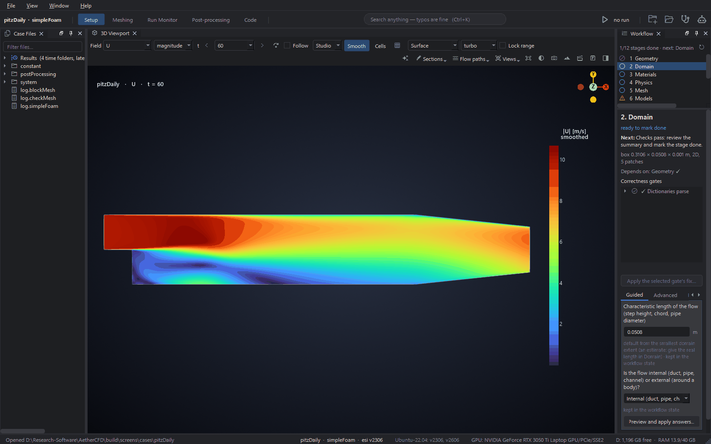

## What you can do

### Set up a case with the guided workflow

The Workflow panel splits a case into twelve stages, from geometry to post-processing and ML. Each stage shows
its status, the next action and its correctness gates: dimensions, the pressure reference, U/p pairing, solver
and scheme coverage, checkMesh, y+, species sums, Mach number against the solver, and convergence. Guided mode
asks physical questions and writes the dictionaries as one plan that you approve. Advanced opens the expert
panels and Raw shows the exact files. A stage cannot be marked done while one of its gates fails. To start a new
case, New Case from Template (Ctrl+N) ranks the OpenFOAM tutorials of both forks against your physics.

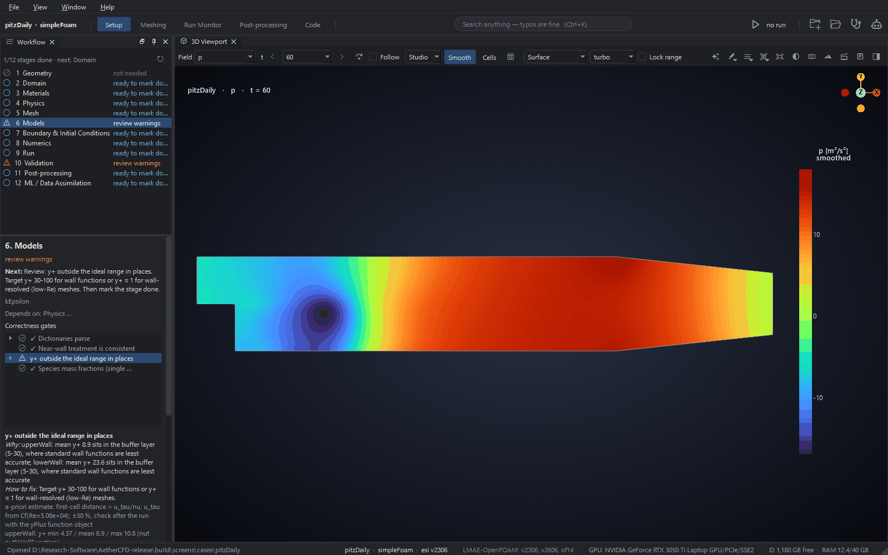

### Mesh and check before you run

AetherMesh shows checkMesh-exact quality maps and hotspot clusters in 3D. It designs blockMesh grading,
estimates the first-cell height for a target y+, takes STL files and CAD (STEP, IGES, BREP and FCStd through
FreeCAD), and sets up snappyHexMesh. The Checks panel runs the numerics lab and the pre-run checks. Each finding
gives its reason and, where there is one, a fix. The fix opens as a plan with the exact diff, and nothing changes
until you approve it.

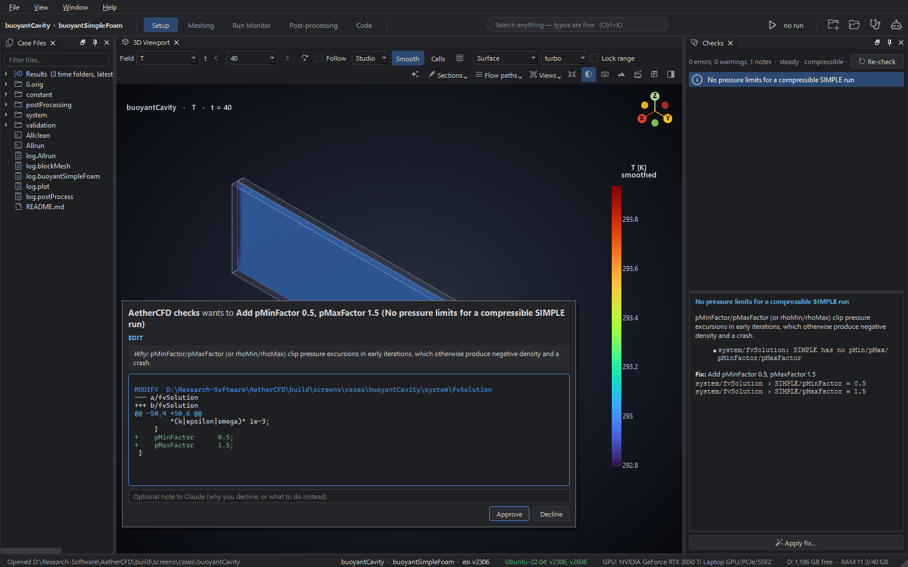

### Run and monitor with guards

Start does what the case needs: the tutorial's own `./Allrun`, or mesh, check and solve, or only the solve. Runs
are detached inside WSL, or go to a Slurm cluster, so closing the app does not stop them. When the app opens
again it reattaches. Residuals and the solver log update while the solver runs, and Write now, Stop & write,
Pause and Kill act on it. Guards stop a run when the log grows too fast or too large, or when free disk space
falls below a reserve. A divergence watchdog stops a run that is clearly diverging, before NaN reaches a
written time, and offers one plan to restart from the last good time with gentler numerics
([docs/divergence.md](docs/divergence.md)).

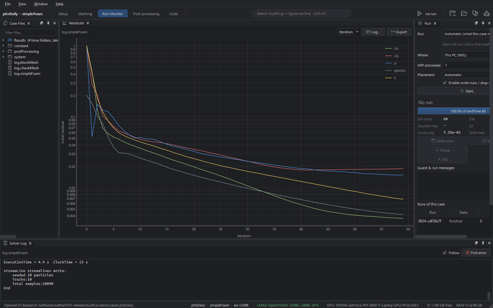

### Post-process

The 3D viewport draws the real finite-volume mesh in two looks. Studio has smooth shading, outlines and a labelled
colour bar. Classic shows the true cell colours, as ParaView does. Showcase gives a first view in one click; on a
3D case that is a mid-plane slice inside a glass shell of the domain. The Visualization panel adds slices, clips,
thresholds, contours, streamlines, glyphs, Q-criterion isosurfaces and schlieren. Render image goes up to 8K, and
Open in ParaView hands the case, field and time to ParaView.

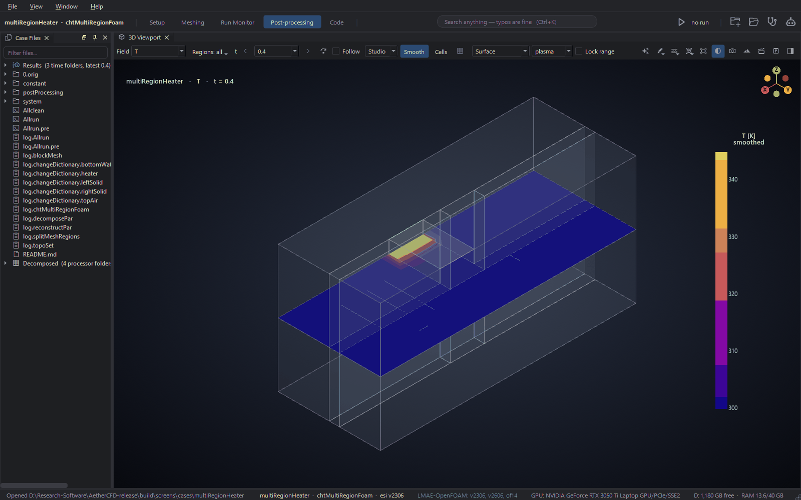

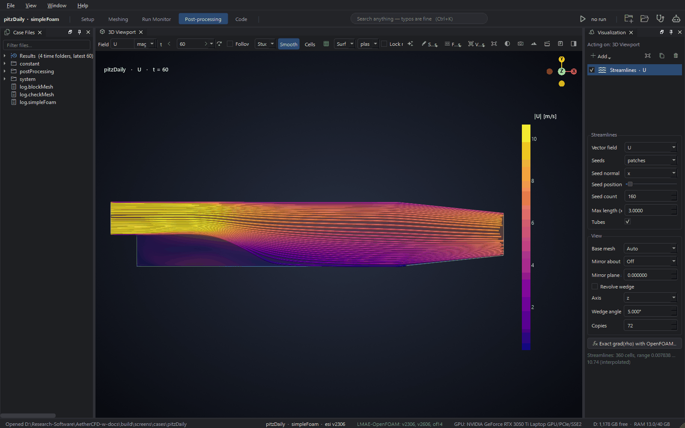

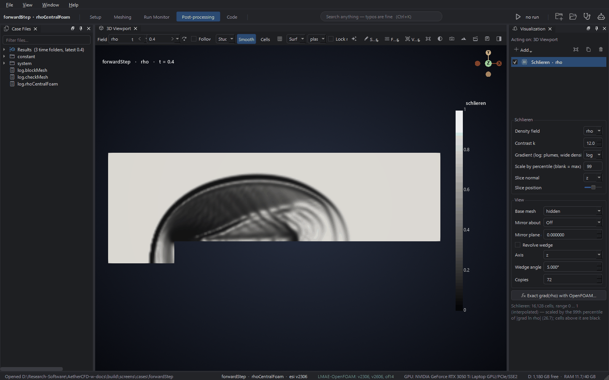

### Multi-region cases

On a conjugate heat transfer case the viewport and the analysis tools know the regions. You can show the solids,
the fluids or any set of regions, and slices and visualization stages use only the regions on screen.

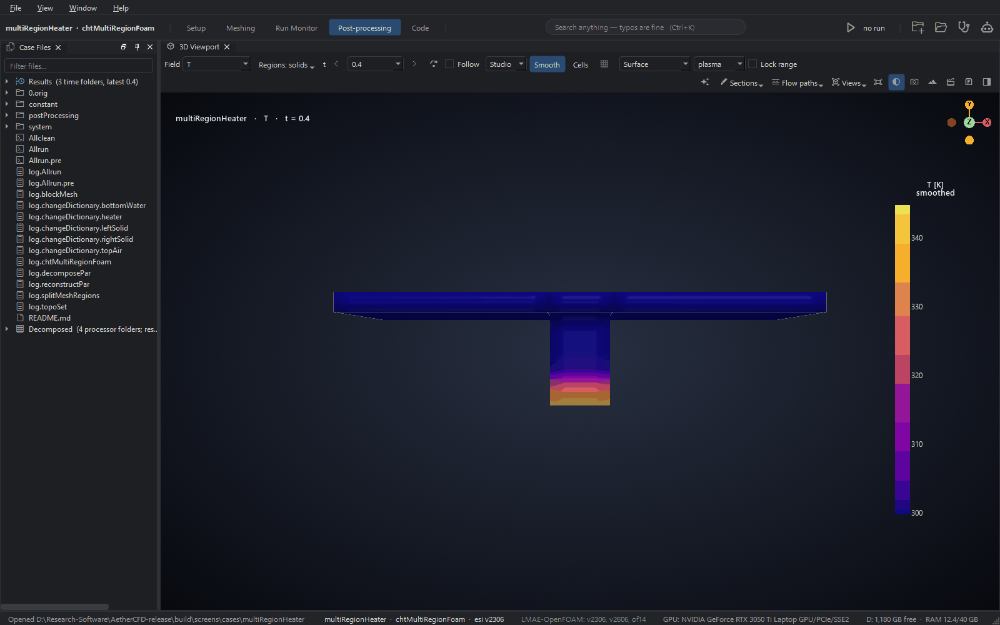

### Analysis and PINNs

The Analysis panel computes POD and DMD modes of the saved times, fits a Gaussian-process surrogate over a table
of runs, and trains physics-informed neural networks (PINNs). A PINN rebuilds a field from sparse data, with
advection-diffusion or incompressible Navier-Stokes as a penalty. It trains in a separate PyTorch environment,
on the GPU when there is one. Every result reports its error against the CFD field on cells the network did not
train on. Read [docs/pinn.md](docs/pinn.md) before you use a result. The Python Console gives you the open case
as numpy arrays, and Measurements compares experiment with simulation.

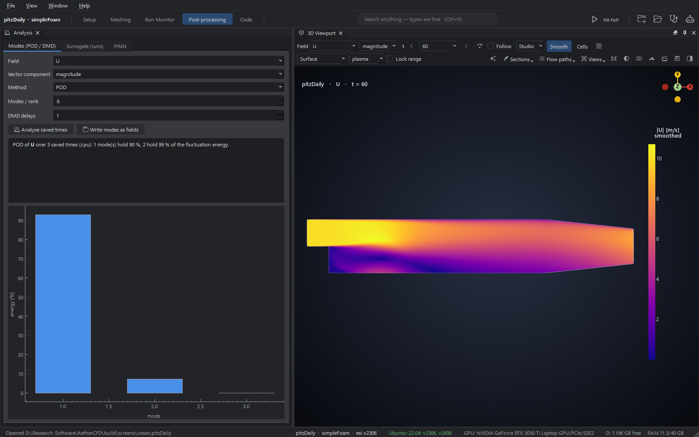

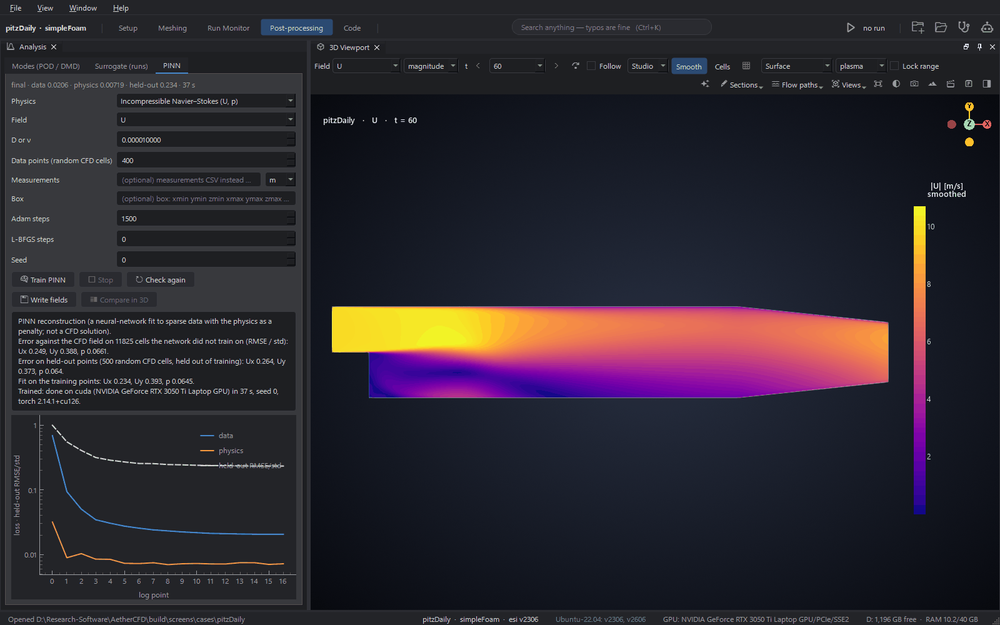

### The copilot and its approval rule

The copilot is Claude Code (the default) or the OpenAI Codex CLI, signed in with your own account. It reads the
case, the logs and the mesh, runs checks, and drives the app: it opens panels, makes Showcase views and adds
visualization stages. It cannot run shell commands or write files itself. Every edit or run it proposes opens
the approval dialog with the exact plan: the summary, the risk, its reasons and confidence, the file diff and
the commands. An approved change lands in the Command Journal, where you can revert it. The Claude copilot only
runs on a Claude subscription sign-in. See [docs/copilot-accounts.md](docs/copilot-accounts.md).

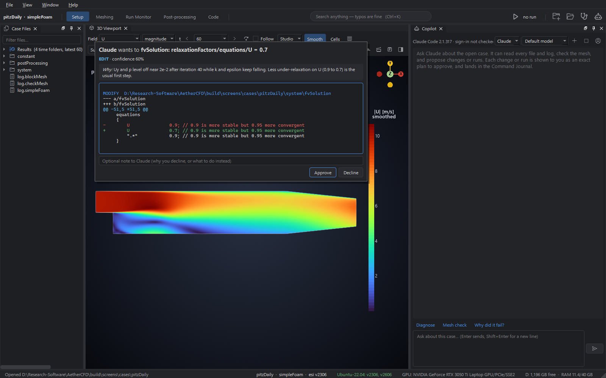

For this picture the screenshot script built the plan itself. No message went to an AI service.

### Light and dark

The app follows the Windows theme, or you pick light or dark. The theme changes live.

<p>
  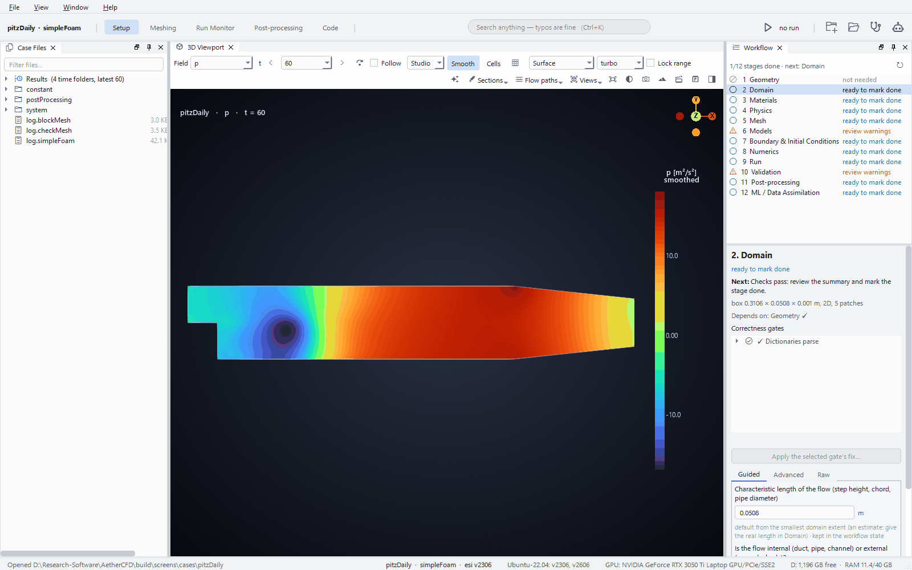
  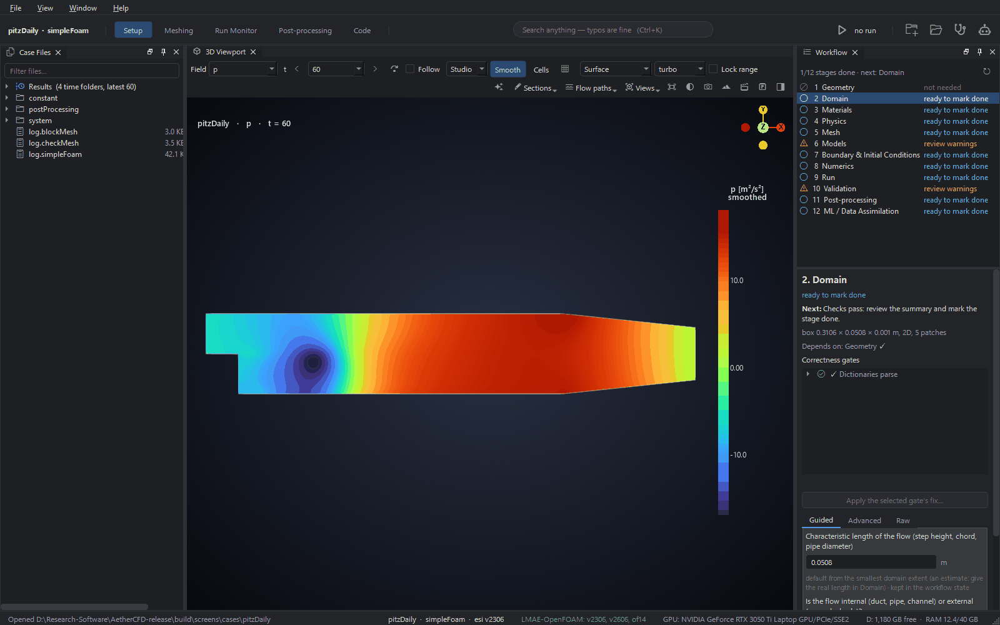
</p>

## Install

The full steps, with a check after each one, are in [INSTALL.md](INSTALL.md). In short:

1. Get the release zip `AetherCFD-<version>-win64.zip` and run `Install AetherCFD.cmd`, or clone the repository with `git clone https://github.com/sidsharma2/AetherCFD.git`.
2. In a clone, check the PC with `powershell -ExecutionPolicy Bypass -File scripts\bootstrap.ps1`.
3. In a clone, install Python and the packages with `uv sync --locked`.
4. Set up WSL and OpenFOAM as [INSTALL.md](INSTALL.md#wsl-and-openfoam) describes.
5. Run `aethercfd doctor` (`uv run aethercfd doctor` in a clone). Each line must say `ok` or `warn`.

This is `aethercfd doctor --quick` from source on the development laptop, shortened (the full output lists every
Python package):

```
AetherCFD 0.1.0.dev0
Python    3.12.13  (D:\Research-Software\AetherCFD\.venv\Scripts\python.exe)
Platform  Windows-11-10.0.26300-SP0

Qt and VTK
  [ok  ] Qt widgets                   PySide6.QtWidgets
  [ok  ] Qt web view (terminal)       PySide6.QtWebEngineWidgets
  [ok  ] VTK OpenGL renderer          vtkmodules.vtkRenderingOpenGL2

GPU
  [ok  ] CUDA compute (CuPy)          NVIDIA GeForce RTX 3050 Ti Laptop GPU, 4.0 GB, CUDA runtime 12.9

WSL and OpenFOAM
  [ok  ] LMAE-OpenFOAM                stopped; OpenFOAM found at the last probe (2026-11-15): esi-v2306, esi-v2606, foundation-14

Optional tools
  [ok  ] ParaView                     C:\Program Files\ParaView 6.1.0\bin\paraview.exe
  [ok  ] FreeCAD                      C:\Program Files\FreeCAD 1.1\bin\FreeCADCmd.exe
  [warn] PyTorch environment (PINNs)  not found
                                      fix: run `uv run python scripts/setup_ml_env.py` in the source folder (INSTALL.md, PINNs)

Copilot
  [ok  ] Claude                       2.1.317 (sign-in not checked: --quick)
  [ok  ] Codex                        0.167.0-alpha.3.2 (sign-in not checked: --quick)

34 ok, 1 warning(s), 0 problem(s): all required parts work
```

## Requirements

- Windows 11, 64-bit.
- WSL 2 with OpenFOAM ESI v2306 or v2606, or OpenFOAM Foundation 14. Without it you can still open cases and look
  at results.
- Optional: an NVIDIA GPU. The 3D view, GPU post-processing and PINN training use it, and fall back to the CPU
  without it.
- Optional: a PyTorch environment for PINNs. Make it with `aethercfd-cli ml-setup` (packaged app) or
  `python scripts/setup_ml_env.py` (source).
- Optional: ParaView for ray-traced renders and Open in ParaView, and FreeCAD for CAD import.
- Optional: Claude Code or the OpenAI Codex CLI for the copilot, with your own account.

## How it is built to be trusted

- The case on disk is the source of truth. The app reads and writes the case files themselves. Its own records
  (journal, run records, provenance) sit in a `.aethercfd` folder inside the case.
- Dictionary edits are lossless. An edit changes the value it targets and keeps every other byte, comment and
  blank line ([ADR 0002](docs/adr/0002-dictionary-roundtrip.md)). A corpus test round-trips every OpenFOAM file
  in our case collection.
- Every change is a plan first. A command shows its exact file diffs and shell commands, waits for approval,
  checks that the files did not change underneath, applies, and writes a journal entry with who, what, why and
  the diff. Journal entries can be reverted. Nothing is hard-deleted: removed files go to the project trash.
- Runs have guards for log growth rate, log size, free disk space and divergence. AetherCFD never runs
  `wsl --shutdown`, `--terminate` or `--unregister`, and never sources two OpenFOAM versions in one shell.
- Crashes and hangs leave records. A GUI thread that stops for 10 s writes `crash/hang-*.txt` with every
  thread's stack, native faults go to `crash/faulthandler.log`, and an unhandled error is shown in the app and
  logged in `studio.log` (all in `%LOCALAPPDATA%\AetherCFD\Cache`).
- Automated tests run on GitHub Actions for every push to `main` and every pull request: ruff and the import
  contracts on Ubuntu, then the unit and studio tests and `aethercfd doctor` on Windows. That set holds 627
  unit tests and 143 studio tests. On GitHub the PINN tests that train a real network are skipped, because
  the runners have no PyTorch environment; they run on the development PC. Another 28 live WSL tests and one
  corpus test need OpenFOAM or our own case collection and also run there.

## Known limits

- Windows only.
- Cluster runs support Slurm only, and they have not been tested on a real cluster yet. The tests use a fake
  Slurm. [docs/cluster-runs.md](docs/cluster-runs.md) lists what to check on the first real job.
- A PINN result is a reconstruction from sparse data, and only steady problems are supported. On the
  turbulent 3-D jet of the REV B.1 case the temperature reconstruction reached only RMSE/std 0.78 to 0.81,
  about as good as predicting the mean everywhere.
- The `--cpu-only` build of `packaging/build.py` is experimental and untested.
- One native crash is not explained. In one of three full runs of the studio tests on the development PC,
  VTK's OpenFOAM reader raised an access violation while it loaded a decomposed 1M-cell case. The same test
  passed in every rerun. `crash/faulthandler.log` records such a crash with the stack of every thread.
- The 3D view recovers a lost OpenGL context with code that depends on internals of pyvistaqt 0.13.1. Check
  `tests/studio/test_viewport_gl_recovery.py` before you upgrade pyvistaqt.
- GPU linear solvers for OpenFOAM are not included.

## Documentation

- [INSTALL.md](INSTALL.md): installing on a new PC, WSL and OpenFOAM, the setup wizard, troubleshooting,
  building and releasing.
- [docs/pinn.md](docs/pinn.md): PINN field reconstruction, its setup and its limits.
- [docs/cluster-runs.md](docs/cluster-runs.md): running cases on a Slurm cluster.
- [docs/copilot-accounts.md](docs/copilot-accounts.md): copilot providers, sign-in and switching accounts.
- [docs/adr/](docs/adr/): design decisions.
- [docs/vision/roadmap.md](docs/vision/roadmap.md): the roadmap.
- [CHANGELOG.md](CHANGELOG.md): changes.

## Development

```
uv sync --locked
uv run aethercfd-studio [case]                    # run from source (--reset-layout ignores saved layouts)
uv run pytest tests/unit tests/studio -m "not wsl and not wsl_slow and not corpus and not gl"   # what CI runs
uv run pytest tests/wsl -m "wsl or wsl_slow"      # live WSL tests (scratch copies only)
uv run pytest tests/corpus -m corpus              # lossless round-trip over our case collection
uv run ruff check src tests packaging scripts     # lint
uv run lint-imports                               # import contracts
uv run python -m aethercfd.studio <case> --smoke  # GUI smoke run with screenshots in build/smoke
uv run python scripts/make_screenshots.py         # regenerate the images in docs/screenshots
uv run python packaging/build.py                  # build and test the packaged app (dist/AetherCFD)
uv run python packaging/install.py                # install it with Start-menu and Desktop shortcuts
```

The headless CLI is `aethercfd` from source and `aethercfd-cli.exe` in the packaged app: `doctor`, `open`,
`run`, `runs`, `control`, `set`, `report`, `clusters`, `copilot` and `ml-setup`.
